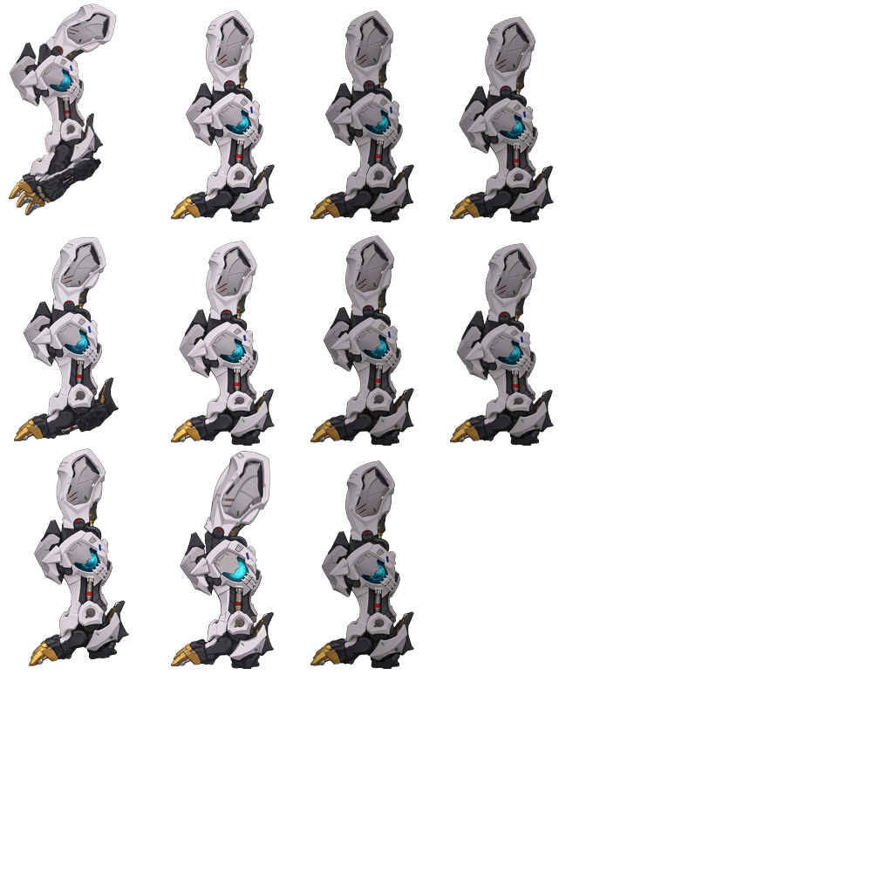

# 01. Fenrir Character Master

## 最高优先级：游戏内角色资产

- 文件：`dist-release/game/assets/fenrir/fenrir-motion-v3.png`
- 用途：当前游戏内芬里尔动作图集和造型基准。
- 规则：后续外部参考只能帮助观察装甲层次、机构和材质，不能覆盖图集中的实际角色设计。

## 官方模型研究来源

### IN ERA+ RMD Fenrir

- [Newtype 产品页](https://newtype.us/p/EFHxsmkCq5FgDiPkuxDx/h/in-era-rmd-fenrir)
- [Newtype 图片 01](https://cdn.shopify.com/s/files/1/2786/5582/files/97708965-052F-482F-A706-0DE07F01AD9A_clipped_1000x.png?v=1773960845)
- [Newtype 图片 02](https://cdn.shopify.com/s/files/1/2786/5582/files/618023508_896926669745186_1469539609402298187_n_1000x.jpg?v=1773960963)
- [Newtype 图片 03](https://cdn.shopify.com/s/files/1/2786/5582/files/619301723_896927306411789_5982126482175330259_n_1000x.jpg?v=1773962601)
- [HPOI 模型资料页](https://www.hpoi.net/hobby/118314)

HPOI 已记录的图片入口：
1. https://rfx.hpoi.net/gk/pic/s/2026/01/a5fa09a78c174f12a744e82bb8fdf82c.jpg
2. https://rfx.hpoi.net/gk/pic/s/2026/01/8a07a4e97c7043a8bad18417e26d5c73.jpg
3. https://rfx.hpoi.net/gk/pic/s/2026/01/0c331c25b3444e9e9093efb7e6b88dd7.jpg
4. https://rfx.hpoi.net/gk/pic/s/2026/01/ccf38d524b0a4d4cbc974918f0afbf7e.jpg

**使用边界：** Newtype 页面将该产品标为 1/72 比例模型。它只能用于观察装甲、内部骨架和机械关节。游戏芬里尔的身高固定为 30 m，模型比例不能替代游戏世界尺度。产品图片许可未确认，因此这里只保留来源链接，不把图片复制进仓库。

## 角色一致性锁定

- 白色与深灰色装甲为主体，保留青色发光眼部/核心、金色结构和红色标识。
- 背包、肩部、腿部和关节比例以游戏母版为准。
- 不因外部模型出现尾部、额外武器、附属装甲或不同脚趾结构，就自动给游戏芬里尔增加这些部件。
- 角色外观的判断应以可核验的原始图和当前游戏图集为准，AI 概念图只用于镜头构图讨论。

## 尚待同步的用户母版

以下文件名在此前的素材任务书中列为优先原始素材，但当前仓库和可访问 Library 检索未找到对应原文件：`42869.png`、`42871.png`、`42872.png`、`42873.png`、`05-side-master-rgba.png`、`04-three-poses-with-anchors.png`。不得自行生成替代品。

`Fenrir-Sole-RGBA.png` 与 `Fenrir-Gemini-three-poses.png` 已在 ChatGPT Library 中找到，尺寸和用途见 [manifest](../99_metadata/reference_manifest.csv)，当前 PR 尚未把这两张原始 PNG 二进制同步到 GitHub。
