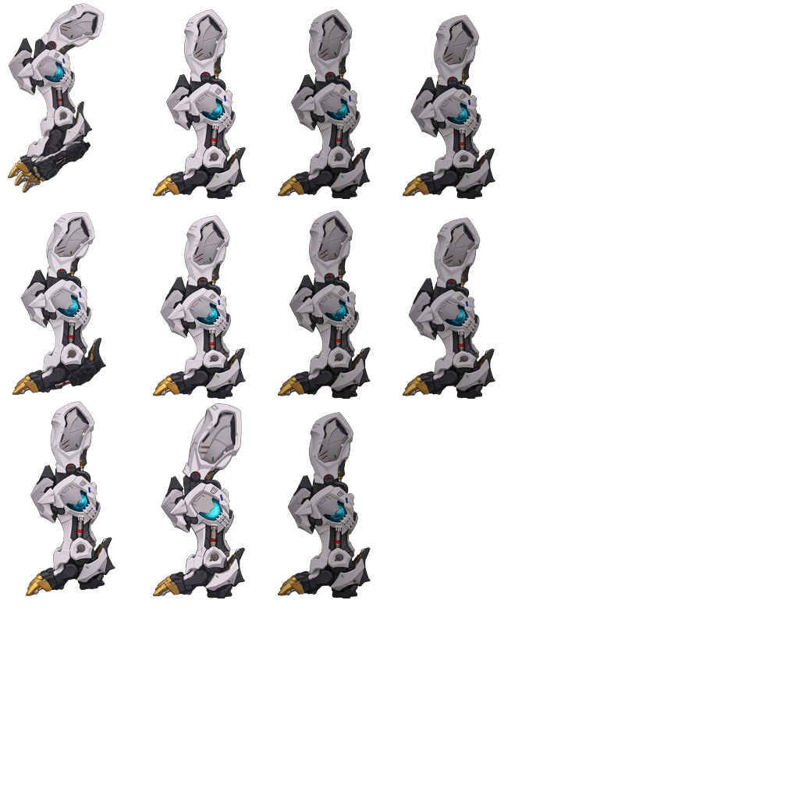

# 04. Sole and Ground Interaction References

这一组把三种材料严格分开：

1. **芬里尔真实脚底结构：** 由用户原始脚掌母版决定。
2. **真实机械与地面摄影：** 只研究液压件、路面、积水和泥土材质。
3. **AI 接地概念图：** 只讨论镜头、碎屑和环境反馈，不能用来重建脚底结构。

## 当前游戏内动作基准

现有 [场景尺度规范](../../../../FENRIR_SCENE_SCALE_V2.md) 记录：
- 水平参考比例：16 px/m。
- 芬里尔 30 m 对应约 480 px。
- 近景道路接触平面：`floor_y = 228`。
- 游戏内接地事件由现有冲击/沉浸层处理，参考图库不应复制或替代运行时逻辑。

## 用户脚底母版索引

以下两张原始图已在 ChatGPT Library 中找到，当前 PR 尚未把二进制文件同步进仓库：

- `Fenrir-Sole-RGBA.png`：812 × 324，透明 PNG，脚底结构母版。
- `Fenrir-Gemini-three-poses.png`：1728 × 994，透明 PNG，站稳、抬脚露底、落地承重三姿态和锚点参考。

它们是本组的结构优先级最高来源。请勿用以下真实液压件照片或 AI 概念图替代这两张母版。

## 液压机构参考

- **Hydraulic cylinder.JPG**
- 作者：S.J. de Waard
- 许可：CC BY 2.5
- [文件页](https://commons.wikimedia.org/wiki/File:Hydraulic_cylinder.JPG)
- 观察重点：缸体、端部连接和液压件外壳。

- **Industrial hydraulic piston pump.jpg**
- 作者：Klankbeeld
- 许可：CC BY-SA 4.0
- [文件页](https://commons.wikimedia.org/wiki/File:Industrial_hydraulic_piston_pump.jpg)
- 观察重点：工业液压设备的管路、缸体和维护结构。它不是芬里尔脚部的直接结构模板。

## 地面材质参考

- **Asphalt road texture.jpg**
- 作者：Kurt Kaiser
- 许可：CC0 1.0
- [文件页](https://commons.wikimedia.org/wiki/File:Asphalt_road_texture.jpg)
- 观察重点：粗糙柏油颗粒和表面微小高差。

- **Moisture and puddles on muddy road.jpg**
- 作者：Anna Bauer
- 许可：CC BY-SA 3.0
- [文件页](https://commons.wikimedia.org/wiki/File:Moisture_and_puddles_on_muddy_road.jpg)
- 观察重点：泥水、浅积水、路面不平和水迹边缘。

## 芬里尔脚底结构锁定

按用户母版检查：
- 三根显著的金色机械趾爪。
- 中央盾形脚底装甲。
- 两侧对称装甲板与斜向通风槽。
- 中央液压活塞及红色环带部件。
- 蜂窝状下接触板。
- 落地帧必须稳定对齐现有接地点和碰撞读取区域。

任何 AI 生成图若出现爪数、趾长、底板、活塞位置或接地几何漂移，都只能标注为概念草图，不能作为结构依据。

## AI 接地概念图索引

`巨型机甲雨夜踏地.png` 与 `雨夜巨型机甲与仰望者.png` 可用于研究低机位、脚掌占画比例、地面碎屑和水花。它们生成的脚底细节与用户母版存在差异，严禁直接用于重建或替换三金趾结构。
